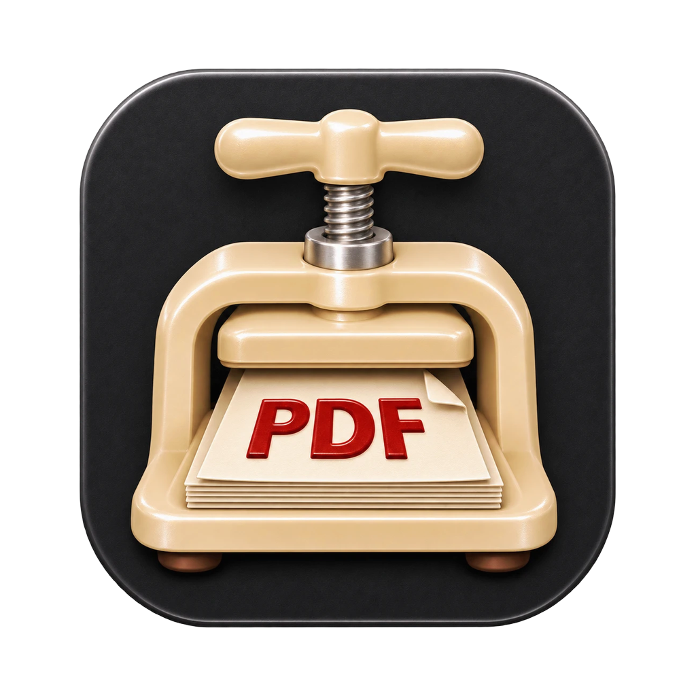

# PDF Compressor Ultra



Нативное приложение для macOS (Swift / SwiftUI, Apple Silicon M1 и новее) для сжатия PDF.

## Уровни сжатия

| Уровень               | Разрешение изображений | Качество |
|-----------------------|-----------------------:|---------:|
| Сильное сжатие        | 72 dpi                 | 50 %     |
| Оптимальное сильное   | 100 dpi                | 60 %     |
| Оптимальное           | 120 dpi                | 75 %     |
| Среднее сжатие        | 144 dpi                | 75 %     |
| Лёгкое сжатие         | 300 dpi                | 80 %     |
| Ручной выбор          | 36–600 dpi             | 10–100 % |

Формат изображений переключается: **JPEGli** (кодер JPEG от Google из libjxl —
файлы на 25–35 % меньше при том же качестве, открываются везде) или **JPEG 2000**.

## Как устроено сжатие

* **Страницы только с текстом и векторной графикой остаются электронными** —
  они никогда не растрируются. Текст можно выделять и искать, шрифты и векторы не теряют качество.
* **На смешанных страницах сжимаются только изображения.** Для каждого изображения
  программа находит, в каком размере оно реально нарисовано на странице, вычисляет
  фактическое разрешение и уменьшает только то, что выше выбранного dpi
  (сглаживающий фильтр по площади), затем перекодирует в JPEGli или JPEG 2000.
  Если перекодирование не даёт выигрыша хотя бы 5 %, остаётся оригинал.
* **Текст и векторы сжимаются без потерь:** все потоки (содержимое страниц, шрифты,
  формы) пересжимаются Flate на максимальном уровне, одинаковые шрифты и изображения
  объединяются, неиспользуемые объекты удаляются, объекты упаковываются в сжатые
  объектные потоки (PDF 1.5), служебные данные Illustrator/Photoshop (PieceInfo)
  и встроенные миниатюры страниц удаляются (отключаемо).
* Маски прозрачности, однобитные сканы (CCITT/JBIG2), изображения с палитрой до 64 цветов
  и CMYK-изображения не сжимаются с потерями (CMYK только уменьшается, без потерь), чтобы не испортить цвета и чёткость.
* Поддерживаются повреждённые таблицы xref, PDF со сжатыми объектными потоками
  и зашифрованные PDF (RC4, AES-128, AES-256); для защищённых паролем файлов
  программа спросит пароль. Результат сохраняется без шифрования.
* Если готовый файл не меньше исходного — сохраняется копия оригинала.
* Результат всегда проверяется: он перечитывается и сравнивается число страниц.

Изображения обрабатываются параллельно на всех ядрах процессора.

## Сборка

Нужны Xcode 15+ (или Command Line Tools) и, для JPEGli, `cmake`:

```bash
brew install cmake
```

```bash
./Scripts/build_app.sh
```

Готовое приложение: `dist/PDF Compressor Ultra.app` (и zip-архив рядом).
Скрипт один раз скачивает и собирает jpegli (libjxl v0.11.1) в `Vendor/jpegli`.
Без cmake можно собрать с системным JPEG-кодером:

```bash
SKIP_JPEGLI=1 ./Scripts/build_app.sh
```

Приложение подписано ad-hoc: при первом запуске откройте его через
правый клик → «Открыть».

Готовая сборка также публикуется GitHub Actions (артефакт `PDF-Compressor-Ultra-arm64`
во вкладке Actions) — workflow собирает приложение на Apple Silicon и прогоняет тесты.

### Открыть в Xcode

`open Package.swift` — схема `PDFCompressorUltra` (приложение) или `pdfcu` (командная строка).

## Командная строка

В комплекте есть утилита `pdfcu` (`dist/pdfcu`, а также внутри .app):

```bash
pdfcu input.pdf -o output.pdf -p optimal -c jpegli
```

```bash
pdfcu scan.pdf --dpi 200 --quality 85 -c jpeg2000
```

Пресеты: `strong`, `optimal-strong`, `optimal`, `medium`, `light`; `--lossless` — только
сжатие без потерь; `--password` — пароль зашифрованного документа.

## Тесты

```bash
pip3 install reportlab pillow numpy pikepdf pypdfium2 pypdf
python3 Tests/make_fixtures.py out/fixtures
python3 Tests/verify.py dist/pdfcu out/fixtures out/results
```

Проверяются: корректность файла (qpdf), число страниц, совпадение извлекаемого текста,
визуальная близость отрисовки (PSNR) и попиксельная идентичность для документов без изображений.

## Структура

* `Sources/PDFCore` — собственный парсер/писатель PDF, анализ размещения изображений, перекодирование.
* `Sources/CCodecs` — zlib и обёртка над jpegli (C).
* `Sources/PDFCompressorUltra` — приложение SwiftUI.
* `Sources/pdfcu` — утилита командной строки.
